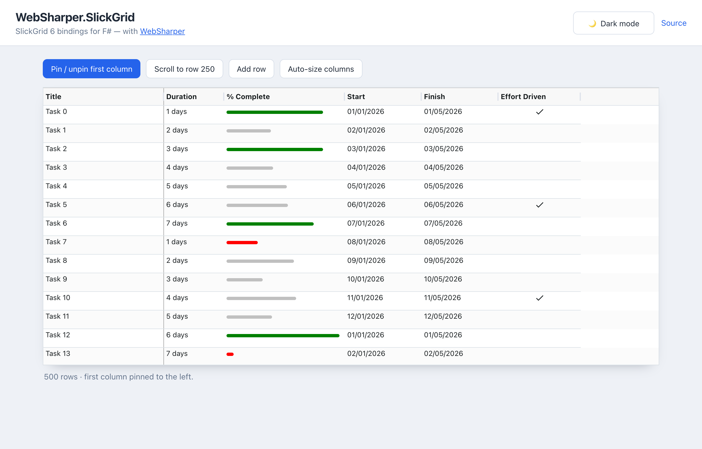

# WebSharper.SlickGrid

[](https://www.nuget.org/packages/WebSharper.SlickGrid)

WebSharper bindings for [SlickGrid](https://github.com/6pac/SlickGrid) 6.0.0 — the
fast, dependency-free JavaScript data grid — for F# and C# web apps.

The binding consumes the npm package [`slickgrid`](https://www.npmjs.com/package/slickgrid)
as an ES module (`import { SlickGrid, Formatters } from "slickgrid"`) and is
bundled by your toolchain (esbuild in the sample); there is no CDN `<script>`
tag. SlickGrid 6 is ESM-only and has no runtime dependencies.

This repository contains:

| Project | Purpose |
| --- | --- |
| `WebSharper.SlickGrid` | The binding: WIG definitions for `SlickGrid`, `SlickDataView`, `Column`, `GridOption`, the formatters, editors, plugins, events and the new 6.x `pinning`/`stickyRows`/`docking` option types. |
| `WebSharper.SlickGrid.Test` | A WebSharper SPA / test case that builds a 500-row grid, pins/unpins a column, adds rows, auto-sizes columns and switches between a light and a dark theme. |

## Live demos

**Try it live:** [Open the sample in your browser](https://dotnet-websharper.github.io/slickgrid/)



The sample doubles as the binding's [test case](#running-the-test-case): it creates
a SlickGrid 6 grid with sortable columns and built-in formatters
(`PercentCompleteBar`, `Checkmark`), exercises the v6 `pinning` option and the
`setColumnPinning` method, appends rows with `setData`/`render`, auto-sizes the
columns and wires an `onClick` event. It is light-themed by default and has a
light/dark theme switcher (persisted in `localStorage`) that also themes the grid
through the SlickGrid CSS variables.

- **Sample (this repository):** <https://dotnet-websharper.github.io/slickgrid/>
- **Source repository:** <https://github.com/dotnet-websharper/slickgrid>
- **WebSharper bindings:** <https://websharper.com/bindings>

## Install

```bash
dotnet add package WebSharper.SlickGrid
```

Or with Paket:

```fsharp
nuget WebSharper.SlickGrid
```

The package targets `netstandard2.0` and works with any WebSharper 10 or 11
project. It supports `slickgrid >= 6.0.0 < 7.0.0`; the library itself is pulled
from npm (`slickgrid`), so the JS bundle step must resolve it (WebSharper's
SPA/esbuild build does this automatically).

## Usage

All types live in the `WebSharper.SlickGrid` namespace. A minimal grid:

```fsharp
open WebSharper
open WebSharper.JavaScript
open WebSharper.SlickGrid

[<JavaScript>]
let ShowGrid () =
    // Register the library stylesheets with the bundler.
    Styles.Grid()
    Styles.AlpineTheme()
    Styles.Icons()

    let columns = [|
        Column<obj>(id = "title", field = "title", Name = "Title", Sortable = true, Width = 220)
        Column(id = "duration", field = "duration", Name = "Duration", Sortable = true, Width = 110)
        Column(id = "percentComplete", field = "percentComplete", Name = "% Complete",
               Formatter = Formatters.PercentCompleteBar, Width = 220)
        Column(id = "effortDriven", field = "effortDriven", Name = "Effort Driven",
               Formatter = Formatters.Checkmark, CssClass = "text-center")
    |]

    let data =
        [| for i in 0 .. 499 do
            yield New [
                "id" => i
                "title" => "Task " + string i
                "duration" => string (1 + (i % 7)) + " days"
                "percentComplete" => Math.Round(Math.Random() * 100.0)
                "effortDriven" => (i % 5 = 0)
            ]
        |]

    // SlickGrid 6: pin the first column with the new `pinning` option.
    let options =
        GridOption(
            EnableCellNavigation = true,
            RowHeight = 34,
            Pinning = PinningOption(Columns = PinnedColumns(Left = 0))
        )

    let grid = SlickGrid("#myGrid", data, columns, options)

    grid.OnClick.Subscribe(fun (_e: Dom.Event, args: OnClickEventArgs) ->
        Console.Log(sprintf "Clicked row %d, cell %d" args.Row args.Cell)
        null)
```

The grid container needs an explicit height:

```css
#myGrid { height: 60vh; min-height: 420px; }
```

### Pinning, sticky rows and docking (new in 6.x)

SlickGrid 6 replaces the old `frozenColumn`/`frozenRow`/`frozenBottom` options
with a single `pinning` option and the grid methods `setColumnPinning`,
`getPinnedColumns`, `setColumnStickiness` and `validateColumnPinning`. Columns
can also carry `Pinned = "left"` / `"right"` and `Sticky = true` directly.

```fsharp
let options =
    GridOption(
        Pinning = PinningOption(Columns = PinnedColumns(Left = 0, Right = 1))
    )

// Toggle pinning at runtime.
grid.SetColumnPinning("title", "left")
grid.SetColumnPinning("title", null)
```

Column stickiness is configured per column (`Sticky = true` / `"left"` / `"right"` /
`"both"`) or with the `stickyRows` grid option, and `docking` tunes the pixel
budgets shared by pinned and sticky bands.

### Theming

`Styles.Grid()`, `Styles.AlpineTheme()`, `Styles.Icons()` and the other `Styles`
members register the SlickGrid CSS files with the bundle. The Alpine theme reads
a set of `--slick-*` CSS variables, so you can restyle (or dark-theme) the grid
without editing the library CSS:

```css
:root[data-theme="dark"] {
    --slick-bg-color: #111c30;
    --slick-odd-row-color: #0e1729;
    --slick-header-bg-color: #0b1424;
    --slick-font-color: #e5eaf3;
    --slick-border-color: #23324a;
}
```

## Notes on the API

- **The package is npm-based and ESM-only.** Nothing is fetched from a CDN; add
  `slickgrid` to your front-end dependencies (WebSharper registers it as an
  `NpmDependencies` entry).
- **`pinning` replaces the frozen-pane API.** `frozenColumn`, `frozenRow`,
  `frozenBottom`, `skipFreezeColumnValidation`, `invalidColumnFreeze*` and the
  `getFrozen*` / `validateColumnFreeze*` methods are gone. Use `pinning`,
  `skipPinningValidation`, `errorCallback`, `invalidColumnPinning*Message`, and
  `getPinnedColumns` / `setColumnPinning` / `validateColumnPinning`. A numeric
  column boundary is **inclusive**: `Left = 0` pins the first column, `Left = 1`
  pins the first two.
- **Hiding columns no longer removes them.** Set `Hidden = true` on a column;
  `GetColumns()` returns hidden columns too — use `GetVisibleColumns()`,
  `GetColumnById`, `GetVisibleColumnIndex` and `UpdateColumnById`.
- **Copy/paste uses the async Clipboard API.** The `bodyElement` and
  `clipboardPasteDelay` options are gone; use `clipboardWriteOverride` /
  `clipboardReadOverride` when the Clipboard API is unavailable.
- **Several deprecated options were removed:** `inlineFilters`,
  `useCSPSafeFilter`, `fastSort`, `customItems` / `customTitle`, the header-menu
  `items` property, `resizeOnShowHeaderRow`, `rowTopOffsetRenderType`,
  `onBeforeAppendCell`, the column `excludeFromQuery`, and the custom-tooltip
  `hideArrow`.
- **New grid options in 6.x:** `pinning`, `stickyRows`, `docking`,
  `skipPinningValidation`, `errorCallback`, `invalidColumnPinning*Message`,
  `allowDragFromClosest`, `columnResizingDelay`, `autoHeaderHeight`,
  `enableVariableRowHeight`, `rowHeightProvider`, `spreadHiddenColspan`, `rtl`.
- **`Styles` is optional.** The `Styles.*` calls only add the CSS imports; skip
  them if you ship the SlickGrid styles yourself.

## Running the test case

The sample is an ASP.NET Core / WebSharper SPA. Build it in Release (this also
installs the npm packages and runs esbuild), then serve the static `wwwroot`:

```bash
dotnet build WebSharper.SlickGrid.Test/WebSharper.SlickGrid.Test.fsproj -c Release
dotnet serve -d WebSharper.SlickGrid.Test/wwwroot -p 8080
```

`dotnet serve` comes from the [`dotnet-serve`](https://github.com/dotnet-serve/dotnet-serve)
tool; install it once with `dotnet tool install -g dotnet-serve`.

Open <http://localhost:8080/>. The buttons drive the whole binding: pin/unpin the
first column, scroll to row 250, add a row, auto-size the columns and toggle the
theme. SlickGrid is fully bundled, so no network access is needed.

## Building from source

### Prerequisites

- [.NET SDK 11](https://dotnet.microsoft.com/download) (preview) — the WebSharper 11
  compiler needs it. The binding itself targets `netstandard2.0`; the sample
  targets `net10.0`.
- [Node.js](https://nodejs.org/) (for the sample's esbuild step).
- [Paket](https://fsprojects.github.io/Paket/) as a local dotnet tool (configured
  in `.config/dotnet-tools.json`).

### Restore and build

```bash
dotnet tool restore
dotnet paket restore
dotnet build WebSharper.SlickGrid.slnx -c Release
```

### Pack the NuGet package

After a Release build (so the assembly and its `.websharper` sidecar exist):

```bash
WSPackageFolder=./out dotnet fsi ./build.fsx -t WS-Package
```

## Deployment

Pushing to the default branch triggers `.github/workflows/ghpages.yml`, which
builds the sample in Release (.NET 11 preview + Paket) and publishes the sample's
`wwwroot` to the `gh-pages` branch via GitHub Pages.

## Repository layout

```
WebSharper.SlickGrid/            # the binding (WIG definitions)
  Main.fs
WebSharper.SlickGrid.Test/       # ASP.NET Core / WebSharper SPA demo / test case
  Client.fs
  wwwroot/
    index.html
    site.css
docs/
  sample.png                     # screenshot of the running sample
nuget/                           # Paket pack template
.github/workflows/ghpages.yml    # build + deploy the sample
build.fsx                        # build stack targets (fake)
```

## License

Apache 2.0 — see [LICENSE.md](LICENSE.md).
